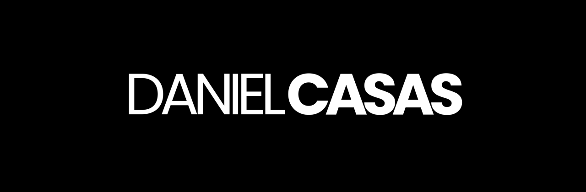

<div align="center">



### Portfolio site — advertising & film director

[](https://roifuries.github.io/daniCasas_int/)
[](#)
[](#)

[](#)
[](#)
[](#)

**English** · [Español ↓](#que-es-esto)

</div>

| Credits | |
| --- | --- |
| 🎨 Design & development | **Roi Furies** |
| 🌐 Web | [rmqz.mx](https://rmqz.mx/) |
| ✉️ Email | [hola@rmqz.mx](mailto:hola@rmqz.mx) |
| 📷 Instagram (design) | [@roifuries2](https://www.instagram.com/roifuries2/) |
| 📷 Instagram (personal) | [@roifuries](https://www.instagram.com/roifuries/) |

---

## ✨ What this is

**Daniel Casas** is an advertising and film director based in Mexico, known for
his work with major brands. This site is his portfolio: a space to showcase
his commercials, his fiction films, and his creative vision.

Animated home where hovering each letter of **CASAS** expands a video behind it,
a Commercials grid and a Films grid (every card plays its Vimeo video as a
muted loop, with an arrow that follows the cursor), a detail page per project
with the video, the credits and a photo layout, plus About and Contact.

Plain HTML, CSS, and JavaScript, **no build step, no dependencies**. Originally
exported from Webflow, now maintained by hand as static files. Served as-is
from any static hosting.

```bash
python3 -m http.server 8000
# open http://localhost:8000
```

---

## 🧭 Project map

<details>
<summary><strong>Pages</strong></summary>

| Page | What it does |
| --- | --- |
| `index.html` | Home — animated hero, each letter of CASAS reveals a video on hover |
| `work/project.html` | **Commercials** grid |
| `work/films.html` | **Films** grid |
| `projects/<slug>.html` | Project detail — Vimeo video, credits, images (one file per project) |
| `about-copy.html` | About |
| `contact/contact-1.html` | Contact |

</details>

<details>
<summary><strong>CSS and JavaScript</strong></summary>

| File | What it does |
| --- | --- |
| `css/casas-b52ba4.wf.css` | 🎨 Site styles — cards, nav, project pages, and one `.bg-image.bg_<slug>` class per project hero |
| `css/estilos.css` | Base Webflow styles and embedded icon font |
| `css/normalize.css` | Style normalization |
| `js/code.js` | ⚙️ Webflow runtime. Its interactions block (search for `"events"`) holds every hover/scroll interaction, keyed by each element's `data-w-id` (this is where the card arrow lives) |

</details>

<details>
<summary><strong>Assets</strong></summary>

| Path | What it does |
| --- | --- |
| `images/` | Logo, favicon, arrow, and older project images |
| `images/00_Projects/NN_<Name>/` | Images for each new commercial |
| `images/00_Projects/00_Films/<Name>/` | Images for each film |
| `videos/` | Self-hosted loops used by the older cards |
| `fonts/` | Octane, Oak Sans, Poppins |

</details>

---

## ➕ How to add a project

New projects use Vimeo, not self-hosted video. You need the Vimeo link, the
client, the project name, the production company, and 3 images.

**1. Images.** Put them in `images/00_Projects/NN_<Name>/` (or
`00_Films/<Name>/` for films), named `<Name>_1`, `_2`, `_3`. Convert them to
JPG — the originals are 5–7 MB each. The page expects three sizes per image:

```bash
sips -s format jpeg -s formatOptions 80 -Z 2400 Name_1.png --out Name_1.jpg
sips -s format jpeg -s formatOptions 80 -Z 1600 Name_1.png --out Name_1-p-1600.jpg
sips -s format jpeg -s formatOptions 80 -Z 800  Name_1.png --out Name_1-p-800.jpg
```

Then delete the PNGs so they aren't duplicated.

**2. Project page.** Copy `projects/snickers.html` to `projects/<slug>.html` and
change: the `<title>`, the `og:` / `twitter:` titles, the `<h1>` (client) and
`.info-project` (project name), the Vimeo `src`, the credits list, the `<h2>`,
and the three image paths. `_1` is the hero background and the last image;
`_2` and `_3` go in the staggered grid.

**3. Hero image.** Add a class in `css/casas-b52ba4.wf.css`:

```css
.bg-image.bg_<slug> {
  background-image: url('../images/00_Projects/NN_<Name>/<Name>_1.jpg');
}
```

and use `bg-image bg_<slug>` on the hero `div`.

**4. Card.** Copy an existing Vimeo card in `work/project.html` (or
`work/films.html`), set the new `href`, the Vimeo ID, the title and the
production company, and give it a **new unique** `data-w-id` (any UUID).

**5. Arrow on hover.** In the interactions block of `js/code.js` (search for `"events"`), clone the three
events whose target is an existing card (`MOUSE_MOVE`, `MOUSE_OVER`,
`MOUSE_OUT`), give them new ids, and point their target to
`66906db7cfb0d2f1a60c957c|<new data-w-id>`. Without this the card works, but the
arrow doesn't appear.

**To remove a project**, delete its card from the grid. You can leave the
project page in `projects/` — nothing links to it.

> 💡 **Titles:** every page uses `Daniel Casas | <Page name>` in `<title>` and
> in the `og:title` / `twitter:title` tags.

> 💡 **Hiding text baked into a video:** add `vimeo-zoom` to the card's video
> `div` (`class="bg-video-work-1 vimeo-work vimeo-zoom"`) to scale it 4% and
> crop the edge. It's used on the Amex card to hide a legal disclaimer.

> ⚠️ **Hover video on the home:** the five letters of CASAS each embed a Vimeo
> player in `index.html` (`.bg-video-letter`). They load with the page, even
> while hidden.

---

<div align="center">

English · **[↑ Español](#)**

</div>

<a id="que-es-esto"></a>

## ✨ Qué es esto

**Daniel Casas** es director de publicidad y cine, basado en México, reconocido
por su trabajo con grandes marcas. Este sitio es su portafolio: un espacio para
mostrar sus comerciales, sus películas de ficción y su visión creativa.

Home animado donde al hacer hover en cada letra de **CASAS** se expande un video
de fondo, un grid de Comerciales y otro de Films (cada card reproduce su video
de Vimeo en loop y sin sonido, con una flecha que sigue al cursor), una página
de detalle por proyecto con video, créditos y fotos, además de About y Contacto.

HTML, CSS y JavaScript planos, **sin build step ni dependencias**. Exportado
originalmente de Webflow y ahora mantenido a mano como archivos estáticos. Se
sirve tal cual desde cualquier hosting estático.

```bash
python3 -m http.server 8000
# abrir http://localhost:8000
```

---

## 🧭 Mapa del proyecto

<details>
<summary><strong>Páginas</strong></summary>

| Página | Qué hace |
| --- | --- |
| `index.html` | Home — hero animado, cada letra de CASAS muestra un video al hacer hover |
| `work/project.html` | Grid de **Commercials** |
| `work/films.html` | Grid de **Films** |
| `projects/<slug>.html` | Detalle de proyecto — video de Vimeo, créditos, imágenes (un archivo por proyecto) |
| `about-copy.html` | About |
| `contact/contact-1.html` | Contacto |

</details>

<details>
<summary><strong>CSS y JavaScript</strong></summary>

| Archivo | Qué hace |
| --- | --- |
| `css/casas-b52ba4.wf.css` | 🎨 Estilos del sitio — cards, nav, páginas de proyecto y una clase `.bg-image.bg_<slug>` por cada hero |
| `css/estilos.css` | Estilos base de Webflow y fuente de iconos embebida |
| `css/normalize.css` | Normalización de estilos |
| `js/code.js` | ⚙️ Runtime de Webflow. Su bloque de interacciones (busca `"events"`) guarda todas las de hover/scroll, ligadas al `data-w-id` de cada elemento (ahí vive la flecha de las cards) |

</details>

<details>
<summary><strong>Assets</strong></summary>

| Ruta | Qué hace |
| --- | --- |
| `images/` | Logo, favicon, flecha e imágenes de proyectos anteriores |
| `images/00_Projects/NN_<Nombre>/` | Imágenes de cada comercial nuevo |
| `images/00_Projects/00_Films/<Nombre>/` | Imágenes de cada película |
| `videos/` | Loops alojados en el sitio, usados por las cards antiguas |
| `fonts/` | Octane, Oak Sans, Poppins |

</details>

---

## ➕ Cómo agregar un proyecto

Los proyectos nuevos usan Vimeo, no video alojado. Necesitas el link de Vimeo,
el cliente, el nombre del proyecto, la productora y 3 imágenes.

**1. Imágenes.** Ponlas en `images/00_Projects/NN_<Nombre>/` (o
`00_Films/<Nombre>/` para películas), con nombres `<Nombre>_1`, `_2`, `_3`.
Conviértelas a JPG — los originales pesan 5–7 MB cada uno. La página espera
tres tamaños por imagen:

```bash
sips -s format jpeg -s formatOptions 80 -Z 2400 Nombre_1.png --out Nombre_1.jpg
sips -s format jpeg -s formatOptions 80 -Z 1600 Nombre_1.png --out Nombre_1-p-1600.jpg
sips -s format jpeg -s formatOptions 80 -Z 800  Nombre_1.png --out Nombre_1-p-800.jpg
```

Después borra los PNG para no duplicar.

**2. Página del proyecto.** Copia `projects/snickers.html` a
`projects/<slug>.html` y cambia: el `<title>`, los títulos `og:` / `twitter:`,
el `<h1>` (cliente) y `.info-project` (nombre del proyecto), el `src` de Vimeo,
la lista de créditos, el `<h2>` y las rutas de las tres imágenes. La `_1` es el
fondo del encabezado y la imagen final; la `_2` y la `_3` van en la cuadrícula
escalonada.

**3. Imagen del encabezado.** Agrega una clase en `css/casas-b52ba4.wf.css`:

```css
.bg-image.bg_<slug> {
  background-image: url('../images/00_Projects/NN_<Nombre>/<Nombre>_1.jpg');
}
```

y usa `bg-image bg_<slug>` en el `div` del encabezado.

**4. Card.** Copia una card de Vimeo existente en `work/project.html` (o
`work/films.html`), cambia el `href`, el ID de Vimeo, el título y la productora,
y dale un `data-w-id` **nuevo y único** (cualquier UUID).

**5. Flecha al hacer hover.** En el bloque de interacciones de `js/code.js` (busca `"events"`), clona los
tres eventos cuyo target es una card existente (`MOUSE_MOVE`, `MOUSE_OVER`,
`MOUSE_OUT`), dales ids nuevos y apunta su target a
`66906db7cfb0d2f1a60c957c|<nuevo data-w-id>`. Sin esto la card funciona, pero la
flecha no aparece.

**Para quitar un proyecto**, borra su card del grid. Puedes dejar la página en
`projects/` — nada enlaza a ella.

> 💡 **Títulos:** todas las páginas usan `Daniel Casas | <Nombre de la página>`
> en `<title>` y en las etiquetas `og:title` / `twitter:title`.

> 💡 **Esconder texto que viene dentro de un video:** agrega `vimeo-zoom` al
> `div` del video de la card (`class="bg-video-work-1 vimeo-work vimeo-zoom"`)
> para escalarlo 4% y recortar el borde. Se usa en la card de Amex para ocultar
> un texto legal.

> ⚠️ **Video del hover en el home:** cada una de las cinco letras de CASAS
> incrusta un reproductor de Vimeo en `index.html` (`.bg-video-letter`). Cargan
> con la página, aunque estén ocultos.

---

<div align="center">

Made with love by **Roi Furies**

[](https://rmqz.mx/)
[](mailto:hola@rmqz.mx)
[-%40roifuries2-E4405F?style=flat-square&logo=instagram&logoColor=white)](https://www.instagram.com/roifuries2/)
[-%40roifuries-E4405F?style=flat-square&logo=instagram&logoColor=white)](https://www.instagram.com/roifuries/)

</div>
